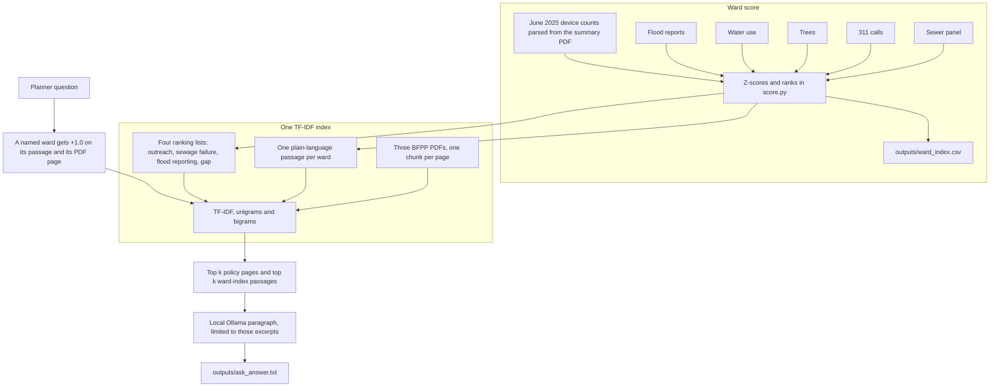

# Ward sewage-risk index (local)

A planner question is answered from two local sources: a ward score built from city tables, and the Basement Flooding Protection Program PDFs. The score itself is arithmetic. The language model only writes a paragraph from passages the search has already retrieved. Nothing in this path calls a paid API.

## Current design

`python3 -m flood_rag.run` builds the ward index and prints the ranking lists. `ask` is the retrieval-augmented path. `eval` runs that same path on three fixed questions and scores it with RAGAS. The places to edit that path are in [RAG.md](RAG.md). Start with `flood_rag/policy.py`, function `ollama_answer`.



Retrieval and generation:

1. Each ward becomes a short passage that states only what is true for that ward: high or low sewage-failure pressure, whether residents rarely report basement floods, device uptake, outreach rank, and the yearly sewer-backup, manhole-overflow, and residential water-use series. Four extra passages list the top of the outreach, sewage-failure, flood-reporting, and gap rankings.
2. Those passages and the PDF pages share one TF-IDF index. Search keeps the top matches from each source, so a policy-heavy question still returns ward rows and the reverse.
3. The local model writes the answer from those excerpts. A ward-index ranking excerpt, when retrieved, is the order of wards to name. Policy excerpts are for what the program offers, who is eligible, and which study area applies.

## What the score is

For each of the 25 wards:

- **Sewage-failure risk** mixes older and combined pipe, foundation-drain density, tree roots over pipe, residential water use, and 311 sewer-backup / manhole-overflow rates per 1,000 eligible homes.
- **Flood reporting** is basement-flood service requests per 1,000 eligible homes, 2019–2022.
- **Outreach rank** (`low_intake_rank`) adds sewage-failure rank, low-reporting rank, and low subsidy participation. Rank 1 is the first ward to contact. A ward can lead on rare reporting and low device uptake even when pipe pressure is not high.
- **Gap rank** is the sum of the sewage-failure rank and the low-reporting rank, so a ward that is only extreme on one side is not described as both.

The script without `ask` prints four lists: highest failure pressure, lowest flood reporting, the overlap of those two top 10s, and subsidy participation.

Eligible homes are the PDF's "with device" plus "without device" counts (the subsidy universe: single-family, duplex, triplex).

The 2025 column uses the 2023 sewer snapshot, adds two years of pipe age, and gives a small credit to wards that installed more new pipe in 2019–2023. Complaint rates stay at the 2019–2021 average. It is a structural update, not a storm forecast.

## Yearly series on the index

The ranking still uses the means. `outputs/ward_index.csv` also keeps each year as its own column, and each ward passage quotes the backup rate, the manhole rate, and residential water use.

311 calls, one column per year for 2019–2022:

- Counts: `sewer_backup_YYYY`, `manhole_overflow_YYYY`, `catch_basin_YYYY`
- Rates per 1,000 eligible homes: `backup_per_1000_YYYY`, `manhole_per_1000_YYYY`

The score columns `sewer_backup`, `manhole_overflow`, `catch_basin`, `backup_per_1000`, and `manhole_per_1000` remain the 2019–2021 mean. The 2022 call columns are a partial extract, so they are stored and left out of that mean.

Residential water use, one column per year for 2019–2022: `avg_residential_usage_YYYY`. The score column `avg_residential_usage` remains the mean of those four years.

## `flood_rag` modules

| Module | What it does |
|---|---|
| `paths.py` | File locations for the sewer panel, 311 calls, trees, water billing, flood workbook, policy PDFs, and `outputs/`. |
| `score.py` | Builds the ward index. Joins the tables, keeps the yearly 311 and water series, computes z-scores and ranks, and writes one plain-language passage per ward plus the four ranking lists. |
| `policy.py` | Reads the three BFPP PDFs, parses June 2025 device counts from the summary, and searches PDF pages and ward passages in one TF-IDF index. A named ward gets a score boost. `ollama_answer` asks the local model to write from those excerpts only. |
| `run.py` | Command line. With no subcommand it builds `outputs/ward_index.csv` and prints the ranking lists. `ask` retrieves and generates. `eval` hands the same path to the RAGAS scorer. |
| `evaluate.py` | Asks three questions whose reference answers are the ward ranks, then scores context recall, faithfulness, and factual correctness with a local Ollama judge. Writes `outputs/ragas_eval.csv`. |
| `__init__.py` | Marks the folder as a package. The entry point is `python3 -m flood_rag.run`. |

## Run

```bash
python3 -m flood_rag.run
python3 -m flood_rag.run ask "Which wards should we outreach because sewer backups are high, few residents report basement floods, and few homes already have a subsidized device?"
```

The score is written to `outputs/ward_index.csv`. The generated paragraph is written to `outputs/ask_answer.txt`.

The default model is `qwen2.5:1.5b` (about 1 GB, CPU). Install Ollama, then pull it once:

```bash
# install from https://ollama.com then:
ollama pull qwen2.5:1.5b
python3 -m flood_rag.run ask "Why might Scarborough wards show low subsidy intake?"
```

`llama3.2:1b` is the other cheap option. Do not send the ward tables to a paid API; the CSV already has the ranking. Pass `--model` to use another local Ollama model.

## Evaluation

`eval` asks three questions, retrieves from both sources, generates an answer, and scores that run with RAGAS. The reference answers are the ward ranks, not a hand-written essay. The judge is the same local Ollama model unless `--judge` names another one.

```bash
python3 -m flood_rag.run eval
```

The table is written to `outputs/ragas_eval.csv`.

- **Context recall** asks whether the retrieved excerpts cover the reference.
- **Faithfulness** asks whether the answer stays inside those excerpts.
- **Factual correctness** compares the answer with the reference ranks.

On the local `qwen2.5:1.5b` judge, that run scored faithfulness 1.00 and factual correctness 0.33. Context recall was blank because the small model did not return a verdict RAGAS could read. A larger local judge fills that metric. These scores check this pipeline. They are not a published benchmark.

## Data used

| Piece | File |
|---|---|
| Sewer features, 25 wards, 2019–2023 | `sewer/ward_sewer_features_panel_2019_2023.csv` |
| 311 sewage-related calls | `311 service request/2019_2022_25ward_311_service_request_info.txt` |
| Trees and distance to gravity mains | `trees_data/trees_by_ward25_2019_2022_with_sewer.xlsx` |
| Residential water use | `Water billing/Water_Consumption_2019.xlsx` … `2022` |
| Basement flood reports and subsidy approvals | `data/raw/basement-flooding-by-ward.xlsx` (Toronto Open Data) |
| Ward profile summaries, June 2025 subsidy stock | `policy context/Basement Flooding Protection Program Summary .pdf` |

The other two PDFs in `policy context/` are the program status update and the 2026–2030 capital briefing note. They are searched with the summary. They are not parsed into the score.

The 44-ward sewer panel is not mixed into this score. Those polygons are a different geography.

## Not in this first cut

Ward-profile census fields (low-rise counts from the Open Data ward profiles) are not in the folder yet. The PDF eligible-home counts stand in for that denominator. Low-rise density from the ward-profile dataset would be a better exposure measure once that file is added.
